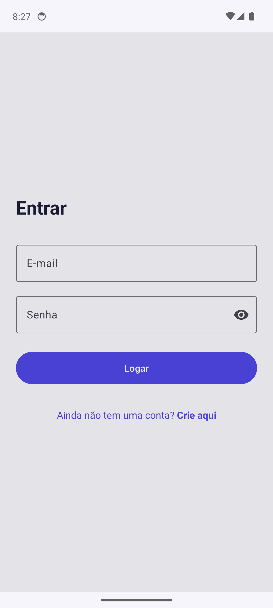
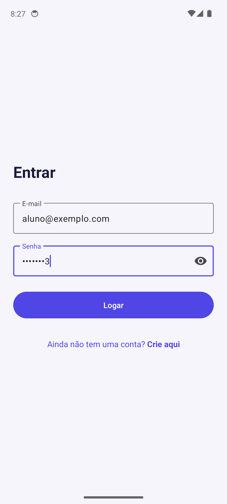
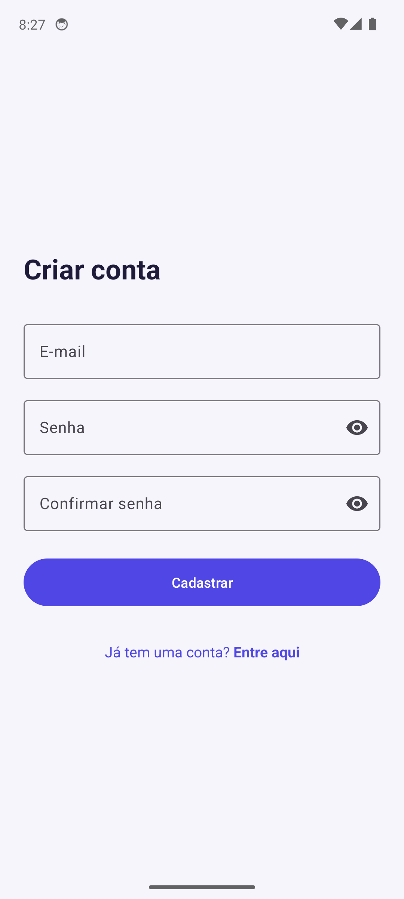
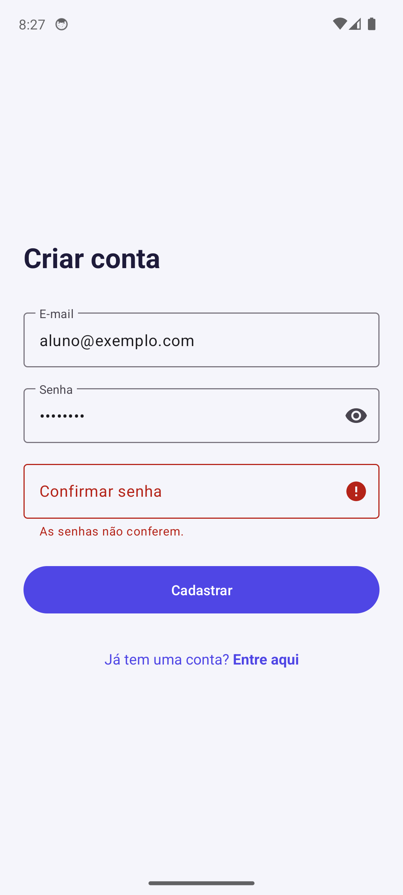
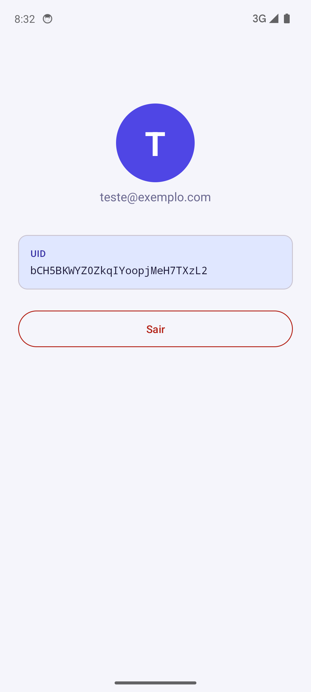

# AppAuthFirebase: Login e cadastro com Firebase Authentication

**Participantes:**

- Bruno Barros - RA: 131037
- Guilherme Pompeo Verrone - RA: 216361

**Disciplina:** Desenvolvimento para Dispositivos Móveis
**Professor(a):** ALESSANDRO FERREIRA PAZ DE LIMA

## Sobre o projeto

Aplicativo Android em Kotlin com autenticação via Firebase Authentication (e-mail e senha), com telas próprias.

- **Login** (primeira tela): e-mail, senha e botão **Logar**, com validação dos campos e mensagens de erro.
- **Cadastro**: o link "Ainda não tem uma conta? Crie aqui" abre a tela de cadastro (e-mail, senha e confirmação).
- **Perfil**: após entrar, mostra avatar com a inicial, e-mail, nome (quando houver) e UID do usuário.
- **Sair**: botão que encerra a sessão e volta para a tela de login.

## Tecnologias

- Kotlin
- Firebase Authentication (e-mail/senha)
- Material 3 e ViewBinding

## Prints

| Login                              | Login preenchido                              |
| ---------------------------------- | --------------------------------------------- |
|  |  |

| Cadastro                                 | Cadastro com erro de validação                    |
| ---------------------------------------- | ------------------------------------------------- |
|  |  |

| Perfil e botão Sair                  |
| ------------------------------------ |
|  |

## Como rodar

1. Crie um projeto no [Console do Firebase](https://console.firebase.google.com) e adicione um app Android
   com o pacote `com.example.tp07_authfirebase`.
2. Em **Authentication > Sign-in method**, ative o provedor **E-mail/senha**.
3. Baixe o `google-services.json` e coloque em `app/google-services.json`
   (o arquivo está no `.gitignore`; há um modelo em `app/google-services.json.example`).
4. Abra no Android Studio e execute.

## Estrutura

- `view/LoginActivity.kt`: tela de login.
- `view/RegisterActivity.kt`: tela de cadastro.
- `view/MainActivity.kt`: perfil do usuário e botão de sair.
